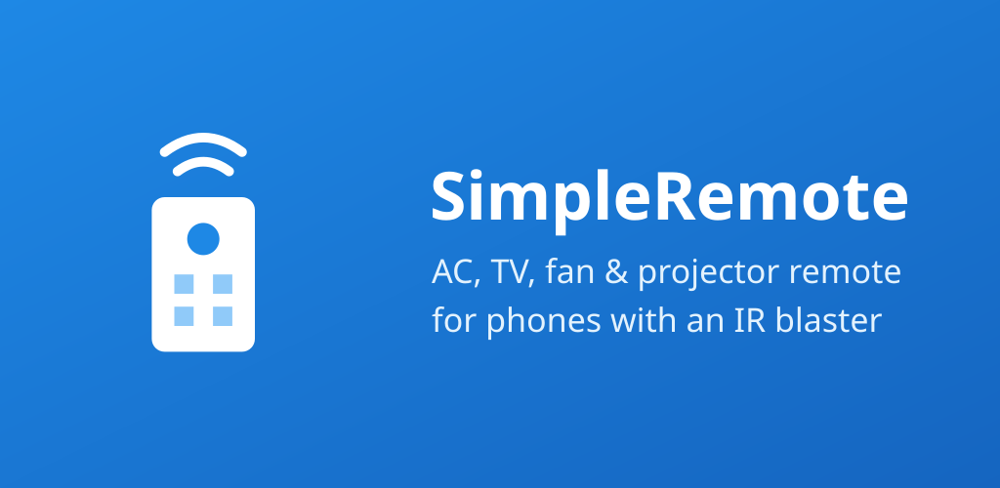
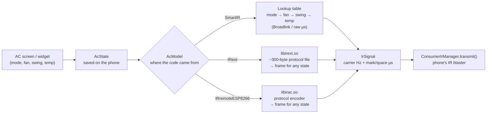

<p align="center">
  
</p>

<p align="center">
  <b>A free, open-source infrared remote for Android phones with a built-in IR blaster.</b><br>
  No account, no ads, no tracking. Works offline.
</p>

<p align="center">
  <!-- Uncomment once the Play listing is live:
  <a href="https://play.google.com/store/apps/details?id=com.coriumcake.simpleremote"></a><br>
  -->
  
  
  
  
</p>

---

SimpleRemote turns the IR blaster found on most Xiaomi / Redmi / POCO phones (and some Huawei, Honor,
Vivo, Realme, TCL and older Samsung, LG and HTC phones) into a remote for your **air conditioner, TV,
fan, projector, set-top box, soundbar, lights** and more.

<!-- Screenshots: save phone screenshots in docs/screenshots/ and uncomment.
<p align="center">
  
  
  
  
</p>
-->

## Features

- **Real air-conditioner control.** Each AC remembers its mode, fan speed, swing and temperature,
  and the screen only shows the settings that model actually supports.
- **Guided setup.** Pick a device type and brand, press "Turn ON / Turn OFF", answer "did it work?".
  If your brand is missing, **Try every code** tests one code per protocol across all brands.
- **Model picker.** Know your remote's model number? Pick it and that code is tried first.
- **Home-screen widget.** Power plus the three most useful buttons (AC temperature, TV volume,
  fan speed…) of any saved remote.
- **Big built-in database**, bundled in the app so nothing is downloaded:

  | Device | Code sets | Brands |
  |---|---:|---:|
  | Air conditioners | ~1,900 | ~340 |
  | TVs | ~2,300 | ~330 |
  | DVD / Blu-ray, audio, fans, projectors, set-top & streaming boxes, lights, heaters, air purifiers, cameras, robot vacuums, other | ~2,750 | ~900 |

## How it works

TV-style remotes are simple: **one button = one fixed code**. Air conditioners are not. An AC remote
keeps the whole state on its own display and sends **all of it** (power, mode, fan, swing,
temperature, often a checksum) on every press. So SimpleRemote keeps the AC's state on the phone,
since IR is one-way and the AC can't report back, and builds the matching frame every time you
change something.



Highlights:

- **Three AC engines behind one interface** (`data/AcModel.kt`). Lookup tables from SmartIR, and two
  native C/C++ libraries (IRext and IRremoteESP8266, via JNI) that *generate* the frame for any
  state the way the real remote does.
- **Native encoders on a phone.** IRremoteESP8266 is a microcontroller library. It is compiled with the
  NDK in its unit-test mode, so `IRsend` records the timings instead of toggling a GPIO pin.
- **Button remotes** (TV, fan, …) come from Flipper-IRDB (NEC, RC5, RC6, Samsung, SIRC, … encoded in
  `ir/IrProtocols.kt`, verified against IRremoteESP8266's decoder) and IRext.
- **Code formats.** Broadlink base64 packets (≈30.5 µs ticks) and raw timings are decoded in
  `ir/IrCodec.kt` and trimmed to Android's 2-second transmit limit.
- **Lazy loading.** Small JSON indexes are used for browsing, and a remote's codes are read from assets
  only when it is opened (LRU cache).
- **Tested offline.** Unit tests decode every bundled code and check the AC state lookups.

## Project layout

```
app/src/main/java/com/simpleremote/
  ir/       IrTransmitter (ConsumerIrManager), IrCodec, IrProtocols, JNI bindings
  data/     AC models (SmartIR / IRext / ESP), device catalogs, saved remotes, stats
  ui/       Jetpack Compose screens (home, setup, AC remote, button remotes, about)
  widget/   Home-screen widget and its configuration screen
app/src/main/cpp/   IRext (C) and IRremoteESP8266 (C++) built as shared libraries
app/src/main/assets/ Code databases generated by tools/
tools/      Python converters that build the assets from the upstream databases
server/     Optional Cloudflare Worker + D1 for opt-in anonymous code statistics
```

## Build

```bash
./gradlew assembleDebug        # app/build/outputs/apk/debug/app-debug.apk
./gradlew testDebugUnitTest    # decodes every bundled code and checks state lookup
```

AGP 8.11 · Kotlin 2.2 · Jetpack Compose · NDK 28 · minSdk 23 · targetSdk 36.
Build without the native AC decoders with `-Pirext=false` (then only SmartIR AC remotes are offered).

### Regenerating the code databases

The databases are converted at build time from their upstream projects, for example:

```bash
git clone --depth 1 https://github.com/smartHomeHub/SmartIR.git /tmp/SmartIR
python3 tools/convert_smartir.py /tmp/SmartIR
```

See the other `tools/convert_*.py` scripts for IRext, Flipper-IRDB and IRremoteESP8266.

## Release (Google Play)

```bash
./gradlew bundleRelease        # app/build/outputs/bundle/release/app-release.aab, signed with the upload key
```

The upload key lives **outside the repo** in `~/keys/simpleremote-upload.jks`, and its passwords are in
`~/keys/simpleremote-keystore.properties` (or pass `-PkeystoreProps=/path/to/file`). Without that file the
release build is left unsigned. Back up both files: Play App Signing lets you reset a lost upload key,
but only through Google support.

- Application id: `com.coriumcake.simpleremote` (the Kotlin package stays `com.simpleremote`)
- Bump `versionCode` in `app/build.gradle.kts` for every upload
- Store text, data-safety answers and graphics: [`store/`](store/listing.md)
- Privacy policy: [PRIVACY.md](PRIVACY.md)

## Contributing

Is your device missing, or does a code not work? [Open an issue](https://github.com/CoriumCake/SimpleRemote/issues)
with the brand, the model number (usually on the back of the remote) and the device type.

## Credits and licenses

SimpleRemote stands on these open projects:

| Project | Used for | License |
|---|---|---|
| [SmartIR](https://github.com/smartHomeHub/SmartIR) | AC code tables | MIT |
| [IRext](https://github.com/irext) | AC and device protocol database + C decoder | MIT |
| [IRremoteESP8266](https://github.com/crankyoldgit/IRremoteESP8266) | AC protocol encoders (C++) | LGPL-2.1 |
| [Flipper-IRDB](https://github.com/Lucaslhm/Flipper-IRDB) | TV, fan, projector, audio and other remotes | CC0 |
| [AirBridge](https://github.com/bejranonda/AirBridge) | Thai-market AC protocols (Saijo Denki) | MIT |

IRremoteESP8266 (`app/src/main/cpp/irremoteesp8266/`) is built as its own shared library, `libirac.so`
(see `app/src/main/cpp/Android.mk`), so it can be replaced. Full license texts are in
`app/src/main/assets/licenses/` and in the app's About screen.

Brand names are used only to identify compatible devices. SimpleRemote is not affiliated with any
device manufacturer.
